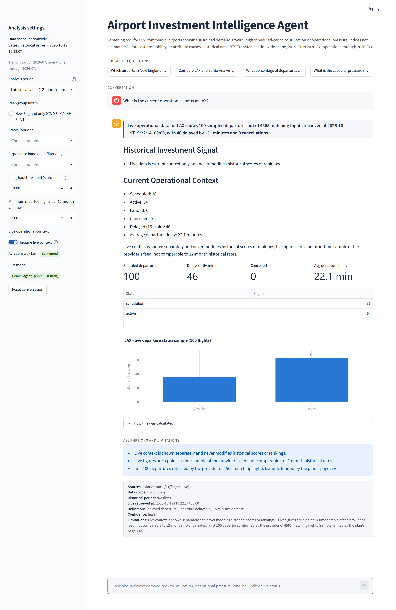

# Airport Investment Intelligence Agent

A conversational analytics app that helps analysts identify U.S. airports worth investigating for modernization or expansion. It combines public aviation data, deterministic calculations and an AI agent that selects analytical tools and explains their results.

**Purpose:** screen opportunities using passenger growth, seat utilization and operational pressure. Investment returns and direct unmet demand require additional data.

**Design document:** [Architecture, scoring methodology, tradeoffs and AI usage](docs/architecture.md).

## Quick start

Requires **Python 3.11+** and Git. Run the commands from the project directory. The app runs locally; no cloud deployment is required.

### 1. Download the project

```bash
git clone https://github.com/eladcohen333/Airport-Investment-Intelligence-Agent.git
cd Airport-Investment-Intelligence-Agent
```

### 2. Install dependencies

Choose the block for your operating system. Keep this terminal open for the remaining steps.

**Windows Command Prompt (`cmd.exe`):**

```bat
py -3 -m venv .venv
.venv\Scripts\activate.bat
python -m pip install -r requirements.txt
copy .env.example .env
```

**macOS / Linux:**

```bash
python3 -m venv .venv
source .venv/bin/activate
python -m pip install -r requirements.txt
cp .env.example .env
```

### 3. Install the prepared historical dataset

**Cloning the repository does not include the database.** Run this command once in the activated environment:

```bash
python scripts/download_dataset_release.py --url https://github.com/eladcohen333/Airport-Investment-Intelligence-Agent/releases/download/dataset-nationwide-2026-07/airport_intelligence_nationwide_2019-01_to_2026-07.zip --sha256 1a66a17b1fdbc92951e7c19933e574a0c0a606b7c1e7021ac2d1128a698d89ed
```

The installer verifies the checksum and database structure, then installs `data/airport_intelligence.duckdb`. It prints `Checksum verified`, the coverage and the refresh time. An existing database is preserved unless `--force` is supplied.

The [published dataset](https://github.com/eladcohen333/Airport-Investment-Intelligence-Agent/releases/tag/dataset-nationwide-2026-07) is **19.3 MiB compressed**, covers **January 2019 through July 2026**, and was refreshed on **19 October 2026**. It contains aggregated historical data and metadata; live API responses and credentials are excluded.

### 4. Choose how to run the agent

Edit `.env` if you want AI or live API access:

| Mode | Configuration | What works |
|---|---|---|
| Demo | Leave API keys empty | Historical analysis through the same tools, using rule-based question routing. Start with the suggested questions; arbitrary phrasing is limited. |
| AI agent | Set `GEMINI_API_KEY` or `ANTHROPIC_API_KEY` | The model interprets questions, selects tools and explains their results. Calculations remain deterministic. |
| Live context | Also set `AVIATIONSTACK_API_KEY` | Current departure-status samples when **Include live context** is enabled. |

`LLM_PROVIDER=auto` chooses Anthropic when its key is present, otherwise Gemini, otherwise Demo. Set `LLM_PROVIDER=anthropic`, `gemini` or `demo` to choose explicitly. Model names are configured by `ANTHROPIC_MODEL` and `GEMINI_MODEL`; use a model available to your account. Restart the app after changing `.env`. Credentials stay local.

### 5. Start the chat

```bash
python -m streamlit run app.py
```

Open the local URL printed in the terminal, normally [http://localhost:8501](http://localhost:8501). Confirm that the sidebar shows the historical coverage and the expected **LLM mode**.

**Once installed, historical analysis in Demo mode needs no external API calls.** AI narration and live context require their respective keys and network access.

## Try these questions

| Analysis | Question |
|---|---|
| Expansion ranking | `Which airports in New England are strong candidates for terminal expansion?` |
| Congestion comparison | `Compare LAX and Santa Ana Airport, SNA, congestion levels.` |
| Conversational follow-up | After that comparison: `What about 2024?` |
| Anchorage route mix | `What percentage of departures from Anchorage, ANC, are long-haul?` |
| SFO capacity pressure | `What is the capacity-pressure signal at SFO and why?` |
| Live API | Enable **Include live context**, then ask: `What is the current operational status at LAX?` |

The SFO analysis addresses the assignment's unmet-demand question with an explicitly labelled proxy and an explanation of what data is missing. It does not estimate a count of unserved passengers or flights.

Open **How this was calculated** to inspect the tool, period, peer group and methodology. The sidebar sets the analysis period, geographic/size filters, minimum flight count and long-haul threshold. Defaults are **500 reported flights per window** for scoring and **2,000 statute miles** for long-haul routes.

## Demo evidence

### Live API call at LAX

[Open the full screenshot](docs/screenshots/01_live_status_lax.png).



Captured **19 October 2026 at 19:22:14 UTC**: Aviationstack returned a sample of **100 departures**, including **46 delayed by 15+ minutes** and **0 cancellations**, from 4,565 matching records. These are captured sample figures, not today's full-airport statistics.

| Additional evidence | Screenshot |
|---|---|
| Ranking with methodology expanded | [New England](docs/screenshots/02_new_england_ranking_methodology.png) |
| Comparison followed by a year-only question | [LAX / SNA and 2024](docs/screenshots/03_followup_context_2024.png) |
| Proxy and its limitations | [SFO](docs/screenshots/04_sfo_capacity_pressure_proxy.png) |

## Data and scope

- **BTS T-100:** passengers, seats, departures and route distance for U.S. origins, scheduled passenger/combination service. All-cargo and charter operations are excluded, including in the Anchorage analysis.
- **BTS On-Time Performance:** delays and cancellations for reporting carriers; coverage is narrower than T-100.
- **OurAirports:** airport reference information, with a BTS-derived fallback.
- **Aviationstack:** optional live REST API. Its one-page sample is shown separately and never changes historical rankings.

Seat occupancy and delays are screening signals. They do not establish a terminal bottleneck, renovation profitability or measured unmet demand. See the [design document](docs/architecture.md) for formulas, uncertainty and tradeoffs.

## Validation and maintenance

| Command | Purpose / requirements |
|---|---|
| `python -m pytest -q` | Unit and integration tests using fixtures and mocked providers; no API keys required. |
| `python scripts/smoke_streamlit.py` | Start the app and check its health endpoint. |
| `python scripts/smoke_llm.py` | Exercise tool calls and follow-ups; needs the installed database and an LLM key. |
| `python scripts/smoke_live.py LAX` | Check Aviationstack access; needs its API key. |
| `python scripts/refresh_data.py --show-metadata` | Inspect the installed dataset's sources and coverage. |

To rebuild from public BTS sources, stop the app and run:

```bash
python scripts/refresh_data.py --scope nationwide
```

This downloads several GB and takes longer than the prepared-data route. `--scope demo` uses the same pipeline with history starting in 2023; it is separate from the no-key Demo agent mode. See [dataset publishing instructions](docs/dataset-release.md) for creating a new release.

**Common issues:** missing database → complete step 3; live unavailable → check the key, toggle and provider quota; model unavailable → check key/model access and the displayed fallback notice; database locked → stop Streamlit before replacing it. Application details are written to `logs/app.log`.
