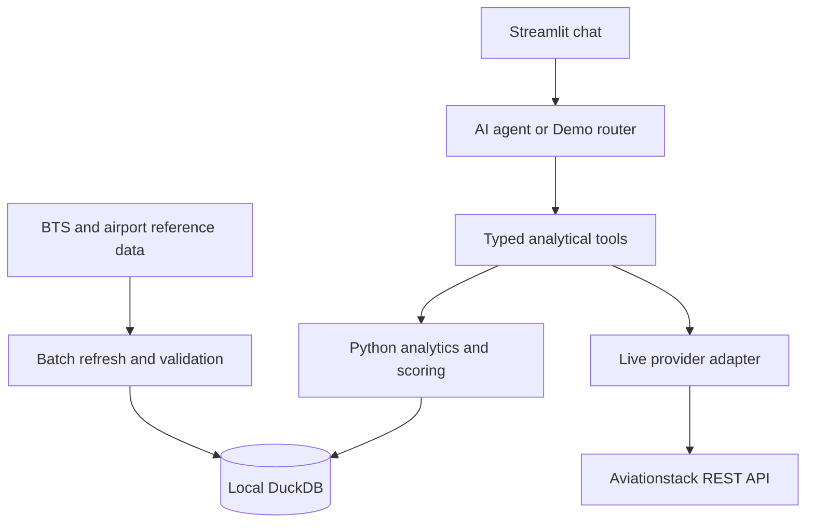

# Short Design & Architecture

## 1. Purpose and approach

The agent screens U.S. airports for modernization opportunities using passenger growth, seat utilization and operational performance. It produces candidates for investigation; profitability, physical terminal constraints and unserved demand require additional commercial/infrastructure data.

| Assignment question | Implemented analysis |
|---|---|
| New England expansion candidates | Rank eligible airports by a deterministic Expansion Opportunity Score. |
| Los Angeles vs Santa Ana congestion | Compare LAX and SNA using delay/cancellation rates and average delay; show flight volume as context. |
| Anchorage long-haul percentage | Divide long-haul departures by all in-scope departures from ANC. |
| SFO unmet demand and why | Explain a Capacity Pressure Proxy, its component contributions and the missing evidence needed to measure unmet demand directly. |

## 2. Architecture and data flow

Streamlit sends the question, filters and session context to the agent. Pydantic validates tool arguments; predefined functions return metrics, status, period, sources, refresh time, confidence and limitations. The UI displays the explanation, tables, charts and methodology.

| Data source | Use and scope |
|---|---|
| BTS T-100 Segment | Passengers, seats, departures and distances. U.S. origins; scheduled passenger/combination service, class F. |
| BTS On-Time Performance | Flights, delays of 15+ minutes and cancellations. Reporting carriers only. |
| OurAirports / BTS fallback | Airport names and locations. Size bands derive from annual origin passengers. |
| Aviationstack `/v1/flights` | Optional current departure sample, up to 100 records. |

Historical inputs are public file downloads; Aviationstack is the live REST integration. Batch refresh validates and aggregates data into six DuckDB tables: airport reference, monthly traffic, operations, routes, score snapshots and refresh metadata. The app reads them through read-only connections and recalculates requested rankings.

A prepared GitHub Release avoids repeating source downloads. Its installer verifies hashes, archive contents and database validity. Installation and refresh replace the database atomically. Live responses never enter this store or change scores.

## 3. Scoring methodology

### Period and raw KPIs

Analysis compares **two adjacent 12-month windows**, ending at the latest usable month shared by traffic and operations. A 2024 request compares calendar 2024 with 2023. Future requests are clamped to coverage and disclosed; unsupported earlier periods return insufficient data.

`P` denotes passengers and `S` seats. Ratios use window totals.

| Metric | Calculation |
|---|---|
| Demand growth, G | `(P_latest - P_prior) / P_prior` |
| Seat-capacity utilization, U | `P_latest / S_latest` |
| Delay rate, D | `Departures delayed 15+ minutes / operated departures` |
| Cancellation rate, C | `Cancelled flights / scheduled flights` |
| Operational pressure, O | `0.70 × D + 0.30 × C` |
| Long-haul share | `100 × departures on segments >= threshold / all in-scope departures` |

Long-haul defaults to **2,000 statute miles**, weighted by departures. ANC's result excludes all-cargo and charter operations.

### Expansion Opportunity Score

Peers match the requested geography and optional size filter, subject to coverage checks. New England is CT, ME, MA, NH, RI and VT.

Clip `G`, `U` and `O` at peer percentiles 5 and 95, then min-max scale each clipped component to 0–100. Constant components map to 50; fewer than two peers yields no normalized expansion score.

**Expansion score = 0.40 × normalized G + 0.35 × normalized U + 0.25 × normalized O.**

Weights prioritize growth, then utilization and pressure; they are design choices, not learned investment predictors. Scores depend on the peer group, so filters can change them. Airport size earns no points.

### Capacity Pressure Proxy

The SFO analysis uses a separate calculation:

**Proxy = 0.50 × utilization percentile + 0.30 × growth percentile + 0.20 × pressure percentile.**

Percentiles use `100 × (average rank - 0.5) / peer count`. Default peers are eligible airports in the same size band across the loaded scope; fewer than five triggers a disclosed fallback to all size bands.

This indicates relative pressure, not quantified unmet demand or causation. Search, booking, fare, leakage or alternative-airport data would be needed.

### Coverage and uncertainty

Scoring requires **500 On-Time flights and 500 T-100 departures in each window**, valid denominators and complete component values. Exclusions show reasons; seasonal airports can pass with incomplete months.

Scoring confidence is a quality heuristic. **High:** 12 months per source/window, at least 10 peers, no quality flags or clamping. **Low:** failed coverage, fewer than 10 months or fewer than five peers. Other eligible cases are **medium**. These labels are not investment-success probabilities.

## 4. Where and how AI is used

One Anthropic/Gemini agent interprets questions, selects tools and explains results. Eight tools cover airport resolution, profiles, ranking, comparison, route mix, capacity pressure, live context and methodology. Python/DuckDB computes all KPIs and scores; the model has no arbitrary SQL tool.

Each turn allows **four iterations and six tool calls**. Structured session context retains airports, periods, filters and the previous analysis. `What about 2024?` can therefore preserve LAX/SNA and change the year. Ambiguous names trigger clarification.

The prompt requires tool-supported figures and caveats. A numeric check permits rounding and flags unmatched figures. Numeric answers without tool calls become clarifications; unmatched figures after tool calls remain visible with warnings. This is not a semantic correctness guarantee.

Without a key, the Demo router handles supported patterns through the same tools. LLM failures fall back to deterministic routing/summaries with a notice. Live failures are reported separately; historical analysis continues.

## 5. Key tradeoffs

| Decision | Benefit and consequence |
|---|---|
| Local Streamlit + DuckDB | Reproducible POC setup; hosted deployment, authentication and multi-user operations remain outside scope. |
| Monthly aggregates / 12-month windows | Fast queries, reduced seasonality; publication lag and no intraday analysis. |
| Heuristic weights / peer normalization | Auditable scores; sensitive to peers, small passenger baselines and unvalidated investment assumptions. |
| Public passenger/operations data | Broad coverage; seat occupancy is not terminal occupancy. Weather/airline issues can drive delays; source coverage differs. |
| Separate live context | Stable historical scores; live results remain a limited sample. |
| Bounded AI tools | Traceable calculations; questions beyond implemented tools need clarification or development. |

## 6. Verification and implementation references

Tests cover formulas, coverage, airport resolution, follow-ups, provider failures and dataset installation. Separate smoke scripts exercise the UI, LLM and live API; [screenshots](screenshots/) capture representative runs. Commands are in the [README](../README.md).

Implementation references: [`scoring.py`](../src/scoring.py), [`tools.py`](../src/tools.py), [`agent.py`](../src/agent.py); reviewed at [revision 0dbaba3](https://github.com/eladcohen333/Airport-Investment-Intelligence-Agent/commit/0dbaba3e7203fde955ac85ae88466c67bdf3cf25), 19 October 2026.
